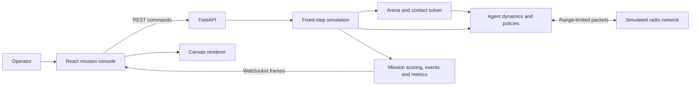

# Architecture

## Engine and agent state

The API holds one in-memory run. Mutations and the simulation clock share a single asyncio event loop. A run can be ready, running, paused, completed, or timed out. Reset creates a new run with the same seed and configuration. The engine's 30 Hz clock is independent of how often a browser receives frames.

Agents own position, velocity, heading, acceleration, maximum speed, health, battery, and local decision memory. The policy chooses a preferred velocity. Shared navigation adjusts it for predicted contacts, then the engine integrates acceleration-limited motion and resolves overlaps. Agents transition among idle, exploring, moving, communicating, avoiding, executing, returning, and failed. Failed drones remain physical obstacles. At 18% battery or below, an operational drone releases its task and returns to its launch station. It rejoins the mission after charging to 94%.

The environment generator places disk obstacles and mission targets using a seed. Moving disks reflect off the arena boundaries. If randomized placement runs out of room, a seeded arrangement of smaller disks preserves the requested counts in dense arenas.

## Simulated radio

Every six ticks, the engine discovers nearby operational radios and offers each sender's immutable report to reachable peers. A report carries the sender ID, simulation timestamp, position, coverage, and the applicable leader, consensus, or task data. Faults and low-battery events are visible in the journal. Leader and task decisions react to local packet expiry after a fault.

Configured packet loss applies per directed delivery. Delayed packets enter a bounded queue. Delivery rechecks radio availability and range, and changing an agent's radio state clears its in-flight traffic. Each agent retains the latest packet per sender. Coverage and task knowledge may propagate across several hops through later broadcasts.

Policies receive local physical contacts, their own memory, grid geometry, and any preplanned destination. The operator's global coverage map, network graph, and metrics remain observation and scoring data.

## Browser transport

REST snapshots and WebSocket frames use the same state shape. Session ID, run ID, and revision identify updates and allow the browser to ignore stale revisions. The stream sends the latest changed frame at the configured rate, shares serialization across clients, and limits visible graph edges to each drone's four nearest links. The metrics use the full graph.

The latest frame goes to Canvas through a ref. Canvas interpolates positions, stores at most 48 trail samples per drone, and redraws on frame or view changes. React consumes coalesced updates for controls and readouts. Charts load a separate history series. The engine stores a sample every simulated second and retains up to 240 recent events.
